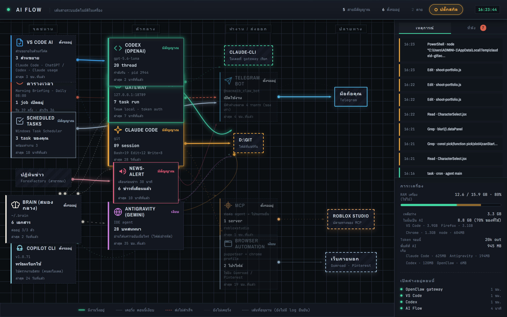

# AI Flow

**A live map of every automation running on my machine, built so it can't show data it hasn't verified.**

I had a scheduler, a chat gateway, a Telegram bot, several AI CLIs and a pile of scripts all running
in the background, and no way to tell which of them were actually alive. This reads their real state
and draws it as a flow: what triggers what, and which paths are moving right now.

## What's interesting in here

- **No mock data anywhere.** It reads session transcripts, a gateway's SQLite database, file
  modification times, and the Windows Task Scheduler. If a source can't be read, the node says so.
- **Verified links look different from assumed ones.** An edge confirmed by a real log entry is
  drawn solid; an edge that's only known from a config file is drawn dashed. The map is not allowed
  to imply it knows something it doesn't.
- **13 data channels** on one screen, each with its own status, last-seen time, and recent events.
- **One place for failures.** Errors from every channel are collected into a single panel instead
  of each system failing silently in its own log.
- **Machine cost is part of the picture** — how much memory and disk the whole AI stack is using,
  measured live, not estimated.

## Stack

Node.js · WebSocket · built-in `node:sqlite` · zero-dependency front end

## Honest notes

This is a single-user local tool, not a product — it binds to localhost only. One of the data
sources shipped without the field the update loop expected, which silently froze live updates until
I traced it; the fix also added a guard so one malformed source can't take the whole loop down again.
